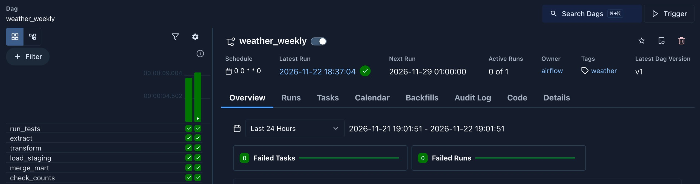

# Weather Data Warehouse: ETL pipeline with DuckDB and Airflow

[](https://github.com/beibarysasqar/weather-dwh-pipeline/actions/workflows/ci.yml)

Loads daily weather for 20 cities and country data from two public APIs, cleans it with pandas
and merges it into a DuckDB star schema. Airflow runs it weekly in Docker; a failing test stops the run.

## What is inside

| Path | What it does |
|------|--------------|
| `data/cities.csv` | 20 cities: `city`, `country_code` (ISO2), `lat`, `lon`. Includes Windhoek, NA (Namibia). |
| `src/config.py` | Settings from `.env` / environment variables with defaults. |
| `src/sources/` | `BaseSource` (`extract`, `clean`, `remove_bad_rows`) and one class per source. |
| `src/load.py` | DuckDB: run a SQL file, load staging, `MERGE` into the mart, check row counts. |
| `src/pipeline.py` | Steps `extract`, `transform`, `load_staging`, `merge_mart`, `check_counts`; CSV files in `data/work/` between steps. |
| `sql/` | All SQL: mart tables, staging load, one `MERGE` file per mart table. |
| `dags/weather_dag.py` | Weekly DAG: `run_tests` >> `extract` >> `transform` >> `load_staging` >> `merge_mart` >> `check_counts`. |
| `tests/` | 9 pytest tests, no network (`requests.get` is mocked), DuckDB in `tmp_path`. |
| `Dockerfile`, `docker-compose.yml` | One Airflow 3.3.2 container in `standalone` mode. |
| `.github/workflows/ci.yml` | `ruff` and `pytest` on push, pull request, weekly and manual run. |

Sources:

- [Open-Meteo Archive API](https://open-meteo.com/en/docs/historical-weather-api): daily `temperature_2m_max`,
  `temperature_2m_min`, `precipitation_sum` per city. No key.
- [World Bank API](https://datahelpdesk.worldbank.org/knowledgebase/articles/889392): country name, region and
  latest population (`SP.POP.TOTL`, `mrnev=1`). Rows with region "Aggregates" are removed. No key.

Model: `staging.*` is replaced on every run. `mart` is a star schema updated with `MERGE`:

- `fact_weather`: `city_id`, `country_code`, `date_key`, `temp_max`, `temp_min`, `precipitation`. One row per city per day.
- `dim_city`: surrogate `city_id` from a sequence, natural key (`city`, `country_code`).
- `dim_country`: `country_code`, `country_name`, `region`, `population`.
- `dim_date`: `date_key` = `yyyymmdd`, plus year, quarter, month, day, day of week, weekend flag.

## Requirements

- Python 3.11 (same as the Airflow image `apache/airflow:3.3.2-python3.11` and CI).
- Docker with Docker Compose for the Airflow part.
- No API keys. Optional `.env`, see `.env.example` (DuckDB path, cities file, work dir, dates, log level).

## How to run

Locally:

```bash
python3.11 -m venv .venv
source .venv/bin/activate
pip install -r requirements.txt
cp .env.example .env
python -m src.pipeline
python -m src.pipeline
```

The second run must log `inserted 0` for every mart table.

Airflow in Docker (UI on http://localhost:8080, no login, local demo only):

```bash
docker compose up -d --build
docker compose exec airflow airflow dags unpause weather_weekly
docker compose exec airflow airflow dags trigger weather_weekly
docker compose exec airflow airflow dags list-runs weather_weekly
docker compose down
```

The DAG loads the 14 days up to the run date. The overlap with the previous week is safe because of `MERGE`.
In Docker the DuckDB file is `./warehouse/warehouse.duckdb` on the host.

Tests and lint: `pytest -v` and `ruff check src tests dags`.

## Results

All numbers are from runs on 2026-11-22, each started with an empty DuckDB file.

Local, `python -m src.pipeline` twice, dates 2024-01-01 .. 2024-12-31 (about 2 s per run):

| Table | Run 1 inserted | Run 2 inserted | Run 2 updated | Rows after run 2 |
|-------|---------------:|---------------:|--------------:|-----------------:|
| `mart.dim_country` | 217 | 0 | 217 | 217 |
| `mart.dim_city` | 20 | 0 | 20 | 20 |
| `mart.dim_date` | 366 | 0 | 0 | 366 |
| `mart.fact_weather` | 7320 | 0 | 7320 | 7320 |

Cleaning: cities 20 extracted, 0 removed; countries 296 extracted, 79 aggregates removed, 217 kept;
weather 7320 extracted (20 cities x 366 days), 0 removed.

Airflow in Docker, two DAG runs with the window 2026-11-09 .. 2026-11-22 (about 9 s per run):

| Table | Run 1 inserted | Run 2 inserted | Rows after run 2 |
|-------|---------------:|---------------:|-----------------:|
| `mart.dim_country` | 217 | 0 | 217 |
| `mart.dim_city` | 20 | 0 | 20 |
| `mart.dim_date` | 14 | 0 | 14 |
| `mart.fact_weather` | 280 | 0 | 280 |

All 6 tasks succeeded in both runs; `run_tests` reported `9 passed`. An earlier run where `run_tests` failed
left all 5 later tasks as `upstream_failed`, so nothing was loaded.

Tests: locally 8 passed, 1 skipped (the DAG test needs Airflow), inside the container 9 passed. Ruff: all checks passed.

"Updated" counts matched rows: `MERGE` rewrites a matched row even when the values did not change.

## Screenshots

Airflow grid view with both successful runs:


